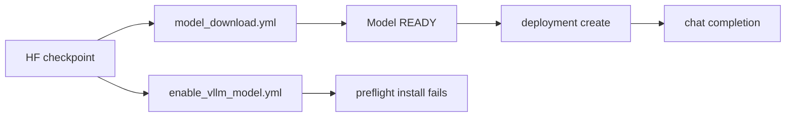

# New-model onboarding findings

Record of one first-time bring-up on 22 Oct 2026 (Pacific). The goal was a model that was not already on Fireworks: upload it into `pyroworks`, serve it, call it, and write down every rough edge. Procedures for repeating the work live in the skills linked below. This page is what those procedures and the public docs do not say.

## What actually stood up

| Item | Value |
| --- | --- |
| Checkpoint | `zai-org/glm-edge-1.5b-chat` at `7b201d3c160c25beda4cf0d107617ad975cd1ca8` |
| Fireworks model | `accounts/pyroworks/models/glm-edge-1p5b-chat` |
| State after upload | `READY`, private, then set `Public: true` by the operator |
| Architecture | `GlmForCausalLM`, model type `glm`, 1,593,427,968 BF16 parameters, context 8192 |
| Upload run | [model_download.yml 39845135642](https://github.com/fw-ai/fireworks/actions/runs/39845135642) on `main` `d94f40cab42876b1d3f90929ed5b6ad484943272`. Finished 1:05 PM PT |
| Deployment | `accounts/pyroworks/deployments/kor9fm3p`. 1x `NVIDIA_H200_141GB`, BF16, one ready replica in `US_VIRGINIA_1`. Operator confirmed a chat call succeeded |
| Failed enable run | [enable_vllm_model.yml 39843565770](https://github.com/fw-ai/fireworks/actions/runs/39843565770). Died in preflight at 12:51 PM PT. No model was created |

The safetensors repo is the one that uploaded. `zai-org/glm-edge-1.5b-chat-gguf` is a different repository (GGUF only).

## Two products share the word "model"

Text and vision-language checkpoints go through upload plus an engine (FireAttention, vLLM, SGLang). Image generation is a separate server with a closed registry in `py/fireworks/serving/image_generation/registry.py` (SD1.5, SDXL, SD3, stable video, talking photo). The only Hugging Face pipeline that registry accepts on its own is `StableDiffusionXLPipeline`.

`black-forest-labs/flux-3-image-klein` is a text-to-image checkpoint (flow-map sampling, a separate text encoder, a separate prompt upsampler). Nothing in this repo implements it. The public upload page and `enable_vllm_model.yml` still look like the path for it.

Native FireAttention model enablement (new kernels and architectures) is a third path. `glm` as in GLM Edge is not that work. The native GLM code in this repo is the MoE family (`glm4_moe`, `glm_moe_dsa`).

## Paths



What worked for the upload was `.github/workflows/model_download.yml` (`stream`, pinned revision, account `pyroworks`, model id `glm-edge-1p5b-chat`). The skill that owns that dispatch is `.cursor/skills/upload-hf-model/SKILL.md`.

What did not work was `.github/workflows/enable_vllm_model.yml`. Preflight runs `pip install` of private `fw-ai/aiconfigurator` at branch `nithiyn/kv-estimator-compat-engine-args`. The runner token can only read `fw-ai/fireworks`. The fallback secret `VLLM_IMAGE_PICKER_PAT_AI_CONFIGURATOR` was empty. The install hides the git error (`2>/dev/null`) and prints "secret not set". The same install step failed the previous Enable vLLM Model run ([39669852350](https://github.com/fw-ai/fireworks/actions/runs/39669852350), LFM2.5). There is no input to skip preflight. Upload, shape, and the call never start.

The public page [Uploading custom models](https://docs.fireworks.ai/models/uploading-custom-models) is the customer-facing version of the upload. Its deploy snippet is `firectl deployment create ... --deployment-shape default`. That flag means "pick an existing validated shape". A model that was just uploaded has none. The opt-out on the CLI is `--accept-shapeless-risk`, which the page does not mention. The page also does not mention `--engine`. The default engine is FireAttention. This GLM checkpoint cannot use it.

`pyroworks` cannot use the on-demand pool. The upload page's next link is the on-demand deployments guide.

## Call and catalog

A dedicated deployment is called with the model and the deployment in one string:

`accounts/pyroworks/models/glm-edge-1p5b-chat#accounts/pyroworks/deployments/kor9fm3p`

POST that as `model` to `https://api.fireworks.ai/inference/v1/chat/completions`. The upload page stops at `deployment create` and never shows this string.

`Public: true` means another Fireworks account can `model get` the resource. It does not place a card on the website models page. That page is ordered by `featured_priority`. The launch convention for a card is a non-zero priority on an `accounts/fireworks` model. `firectl model get` omits the field when it is 0, so the get output for this model has no `Featured Priority` line.

`firectl model list` searches only the account in the profile (`ParentScope` sets `AccountId`). Public models in other accounts are not merged in. The command does not print which account it queried. An empty table is what you get from the wrong account. `firectl model list -a pyroworks --search glm-edge-1p5b` is the query that returned this model.

Deployment `Public` and model `Public` are separate fields.

Taking the replica down without deleting the model:

```bash
firectl deployment delete -a pyroworks kor9fm3p --wait
```

`--hard` deletes the deployment record. `model delete` deletes the checkpoint record. Neither is required to stop the replica.

## Paper cuts

### Choosing a model

1. The upload page says Fireworks supports most popular architectures, then lists text and VLM families. It does not say image models are a closed registry.
2. The onboarding links (that page, `.cursor/skills/pick-vllm-image/SKILL.md`, `enable_vllm_model.yml`) have no branch for "this is not a language model".
3. A Hugging Face repo tagged `text-generation` can be GGUF-only. `zai-org/glm-edge-1.5b-chat-gguf` has no `config.json`, tokenizer, or safetensors. The GGUF header says context 2048. The safetensors `config.json` says 8192.
4. `enable_vllm_model.yml` git-clones the whole repo. A repo that also ships quantized variants uploads all of them. The workflow's default account is `fireworks`. This exercise needed `pyroworks`.

### vLLM image check

5. `aiconfigurator check-compat` is rejected. The command is `aiconfigurator cli check-compat`. Top-level `--help` only lists `cli`, `webapp`, and `version`.
6. Installing aiconfigurator without a token for the private repo fails as "Repository not found".
7. `kv-fit` applies `sliding_window` to every KV layer it counts. On Spark-X2.6-4B the 9 full-attention layers were priced as a 512-token window: 0.09 GiB at context 1,048,576. Hand math for those layers is about 36 GiB. Context 8192 still fits on one H200 either way.
8. A config with `auto_map` gets a passing compat result that never checks whether vLLM implements the class. The note says the image must vendor `modeling_*.py`. For `trust_remote_code` those files come from the checkpoint, and the checker still does not prove they run.
9. `gcloud artifacts docker tags list --sort-by=~UPDATE_TIME --limit=30` did not include mirrored `v0.32.0`. Newest version and most recently pushed are different lists. The checker cannot parse the tag `latest`.
10. This cloud agent can list `docker-mirror/vllm/vllm-openai` and cannot list `inference/vllm/vllm-openai` (`artifactregistry.repositories.get` denied). Fireworks-built tags (`isVllmRelease=false`) were not visible.
11. `isVllmRelease` selects the registry (`true` = docker-mirror of upstream images, `false` = the inference repo of Fireworks-built images). It does not mean "release versus nightly". `image_tag` on the shape workflow is the Fireworks chart. `enable_vllm_model.yml` hardcodes chart tag `4.2.97`. `vllmImageTag` is a different tag. The enable run died before that job.
12. `pick-vllm-image` treats missing `docker` as a hard stop. The compat check itself does not need Docker. Flag probing inside an image does. Docker was not installed here.
13. A model card's `--chat-template` path and `--served-model-name` are local docker settings. Copying `/models/Spark-X2.6-4B/chat_template.jinja` into Fireworks extra args points at a file the pod does not have. Spark's card also serves the 2.6 checkpoint as `spark25`.

### Upload and validation

14. The enable workflow's preflight install failure blocks every model, including one whose compat check already passed locally. See the failed run above.
15. `model_download.yml` validate-upload for GLM Edge exited 0 and printed "validation completed successfully" together with "this architecture is not supported by Fireworks". The detail is the Python class `transformers.models.glm.configuration_glm.GlmConfig`. vLLM has registered `GlmForCausalLM` since 0.6.5 and transformers since 4.46.0. The warning does not name vLLM. It also says to set `parameter_count` by hand after create had already sent it.
16. That first validate does not persist the pinned metadata. The workflow then runs a second `validate-upload` with `--skip-hf-config-validation`, `--model-type glm`, `--parameter-count`, `--context-length`, and `--fireattention-unsupported`. A person following the first message would stop.
17. A green upload does not create a deployment and the summary does not print the next command.
18. `model get` for this model shows `Context Length: 8192` and `Training Context Length: 131072`. The checkpoint's `max_position_embeddings` is 8192. The get does not say where 131072 came from.

### Deploy, call, and catalog

19. `--validate-only` on `deployment create` still returns "error creating deployment" when the failure is authentication.
20. Control-plane and inference both rejected the API key in this cloud agent ("API key not valid" / "The API key you provided is invalid"). Neither error says which key, which environment, or how to get a `pyroworks` login. There is no `~/.fireworks` profile on the agent.
21. The documented deploy line cannot succeed for a model with no validated shape, and it does not say so.
22. `model list` with no `-a` prints only the upgrade banner and an empty table. It looks like the model is missing.
23. `model get` hides `Featured Priority: 0`. The upload page says `--public` lists the model in the public catalog. The website catalog is the featured list.

### Things that were not the failure

Spark-X2.6-4B (`spark2_5`, `trust_remote_code`, hybrid sliding and full attention) was a real compatibility risk. It was not why the enable workflow died. The workflow never read the checkpoint. Switching to GLM Edge did not make `enable_vllm_model.yml` work. Mentioning another agent does not set the missing GitHub Actions secret.

## Related skills

- `.cursor/skills/upload-hf-model/SKILL.md` — weight upload to a `READY` model. Does not create a deployment.
- `.cursor/skills/enable-model-on-vllm/SKILL.md` — vLLM shape after a `READY` model. Shape mutations go through `validate-deployment-shapes.yml`, not `firectl`.
- `.cursor/skills/pick-vllm-image/SKILL.md` — image tag and GPU fit before a vLLM deploy.
- `.cursor/skills/firectl/SKILL.md` — CLI, including the fireworks-account publish gates (`--approved-by`, public validated shape).
